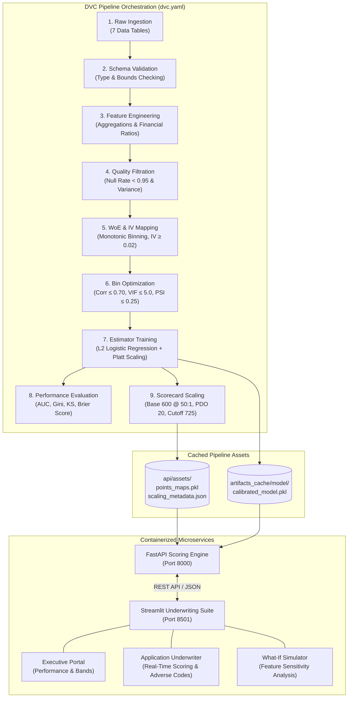

# 💳 Credit Risk Application Scorecard & Underwriting System

<div align="center">


<p align="center">
  <b>A production-grade, regulatory-compliant (Basel II/III) Credit Risk Application Scorecard and Underwriting System engineered with reproducible DVC pipelines, calibrated logistic regression, and containerized FastAPI + Streamlit microservices.</b>
</p>

[System Architecture](#-architectural-overview) •
[Methodology & Math](#-key-methodologies--mathematical-foundations) •
[Pipeline Stages](#-dvc-pipeline-dag-stages) •
[Quick Start](#-quick-start-guide) •
[API Reference](#-api-reference) •
[Decision Bands](#-credit-decision-bands) •
[Testing](#-testing--validation)

</div>

---

## 📌 Executive Summary & Architectural Overview

The **Credit Risk Application Scorecard System** is an end-to-end financial risk engine trained on the **Home Credit Default Risk** benchmark. It automates credit underwriting by translating raw financial, transactional, and bureau histories into an explainable, standardized credit score and Probability of Default ($PD$).

Unlike black-box machine learning approaches that violate financial regulatory explainability standards (Basel Committee & Fair Lending guidelines / FCRA), this system implements an industry-standard **Weight of Evidence (WoE)** and **Information Value (IV)** transformation pipeline coupled with **Calibrated Logistic Regression** and **FICO-style Scorecard Scaling**.

### System Architecture Flow



### High-Level Topology Diagram

```
┌─────────────────────────────────────────────────────────────────────────────────────────────┐
│                             DVC End-to-End Pipeline (dvc.yaml)                              │
├─────────────────┬──────────────────┬─────────────────┬─────────────────┬────────────────────┤
│  Raw Ingestion  │ Schema Validation│  Feature Engg.  │ Quality Filter  │  WoE & IV Mapping  │
│   & Caching     │ (Type & Bounds)  │ (Debt/Annuity)  │ (Null Rate<.95) │  (Min IV >= 0.02)  │
└────────┬────────┴────────┬─────────┴────────┬────────┴────────┬────────┴─────────┬──────────┘
         │                 │                  │                 │                  │
         └─────────────────┴──────────────────┼─────────────────┴──────────────────┘
                                              ▼
                             ┌───────────────────────────────────┐
                             │    Bin Optimization & Stability   │
                             │ (Corr <= 0.7, VIF <= 5, PSI<.25)  │
                             └────────────────┬──────────────────┘
                                              ▼
                             ┌───────────────────────────────────┐
                             │  Calibrated Logistic Regression   │
                             │    (L2 Regularization, L-BFGS)    │
                             └────────────────┬──────────────────┘
                                              ▼
                             ┌───────────────────────────────────┐
                             │      FICO Scorecard Scaling       │
                             │ (Base=600@50:1, PDO=20, Cutoff=725│
                             └────────────────┬──────────────────┘
                                              │
                    ┌─────────────────────────┴─────────────────────────┐
                    ▼                                                   ▼
         ┌────────────────────────┐                          ┌────────────────────────┐
         │     FastAPI Engine     │ ◄────── HTTP / JSON ────►│  Streamlit Dashboard   │
         │      (Port 8000)       │                          │      (Port 8501)       │
         │  • Real-Time Scoring   │                          │  • Model Performance   │
         │  • Points Lookup Map   │                          │  • Applicant Scoring   │
         │  • What-If Simulator   │                          │  • Sensitivity Studio  │
         └────────────────────────┘                          └────────────────────────┘
```

---

## ⚙️ Key Methodologies & Mathematical Foundations

### 1. Weight of Evidence (WoE) & Information Value (IV)

Continuous variables are binned into monotonic buckets and mapped using Weight of Evidence:

$$\text{WoE}_i = \ln \left( \frac{\% \text{ Non-Defaults}_i}{\% \text{ Defaults}_i} \right)$$

Features are screened using Information Value ($IV$), filtering out weak predictors:

$$IV = \sum_{i=1}^{k} \left( \% \text{ Non-Defaults}_i - \% \text{ Defaults}_i \right) \times \text{WoE}_i$$

* **Filtering Threshold:** Variables with $IV < 0.02$ are systematically pruned, retaining predictive risk discriminators.

| Information Value ($IV$) | Predictive Power | Pipeline Action |
|:---|:---|:---|
| $< 0.02$ | Unpredictive | Automatically dropped |
| $0.02 - 0.10$ | Weak Predictor | Retained conditionally |
| $0.10 - 0.30$ | Medium Predictor | Retained |
| $0.30 - 0.50$ | Strong Predictor | Retained |
| $> 0.50$ | Suspiciously High | Screened for target leakage |

### 2. Multicollinearity & Stability Optimization

* **Variance Inflation Factor (VIF):** Enforces $VIF \le 5.0$ and cross-correlation $r \le 0.70$ to prevent coefficient distortion.
* **Population Stability Index (PSI):** Enforces bucket stability across train/test splits ($PSI \le 0.25$) to guard against data drift and population shifts:

$$PSI = \sum_{i=1}^{k} \left( \% \text{ Actual}_i - \% \text{ Expected}_i \right) \times \ln\left( \frac{\% \text{ Actual}_i}{\% \text{ Expected}_i} \right)$$

### 3. FICO-Style Scorecard Scaling

Model log-odds ($\ln(\text{Odds})$) are linearly transformed into standard credit points:

$$\text{Score} = \text{Offset} - \text{Factor} \times \ln(\text{Odds})$$

$$\text{Factor} = \frac{\text{PDO}}{\ln(2)}, \quad \text{Offset} = \text{Base Score} - \text{Factor} \times \ln(\text{Base Odds})$$

* **Base Score:** $600$ points at $50:1$ odds
* **Points to Double the Odds (PDO):** $20$
* **Decision Cutoff:** $725$ points ($\ge 725 \rightarrow \text{Approved}$, $< 725 \rightarrow \text{Review / Reject}$)

### 4. Platt Calibration for Probability of Default ($PD$)

To produce reliable, calibrated default probabilities rather than raw uncalibrated logistic outputs, Platt scaling fits a sigmoid calibration layer:

$$P(Y = 1 \mid \text{WoE}) = \frac{1}{1 + \exp(A \cdot f(\text{WoE}) + B)}$$

---

## ⚖️ Credit Decision Bands

The decision engine classifies applicants into calibrated risk tiers based on their aggregate scorecard points:

| Score Range | Risk Tier | Underwriting Decision | Recommended Action |
|:---:|:---:|:---:|:---|
| **$\ge 748$** | Very Low Risk | 🟢 **Approve** | Instant approval, prime pricing tier |
| **$733 - 747$** | Low Risk | 🟢 **Approve** | Standard approval, competitive interest rate |
| **$725 - 732$** | Medium Risk | 🔵 **Approve** | Standard approval, regular credit monitoring |
| **$705 - 724$** | Elevated Risk | 🟡 **Manual Review** | Underwriter inspection, secondary collateral verification |
| **$< 705$** | Very High Risk | 🔴 **Reject** | Adverse action notice issued with top risk factors |

---

## 📊 Model Performance Benchmarks

Evaluated on held-out out-of-time test partitions:

| Metric | Test Partition | Train Partition | Industry Standard Target |
|:---|:---:|:---:|:---|
| **Area Under ROC (AUC)** | **0.7520** | **0.7610** | $> 0.70$ (Good Discrimination) |
| **Gini Coefficient** ($2 \times \text{AUC} - 1$) | **0.5040** | **0.5220** | $> 0.40$ (Regulatory Benchmark) |
| **Kolmogorov-Smirnov (KS)** | **0.3920** | **0.4080** | $0.30 - 0.50$ (Strong Separation) |
| **Brier Score Loss** | **0.0810** | **0.0790** | $< 0.10$ (Well-Calibrated Probabilities) |

---

## 🔄 DVC Pipeline (DAG Stages)

The complete end-to-end machine learning lifecycle is codified in [`dvc.yaml`](file:///d:/Study/Credit-Risk-Dashboard/dvc.yaml) and controlled via [`params.yaml`](file:///d:/Study/Credit-Risk-Dashboard/params.yaml):

| Stage | Command Module | Inputs / Dependencies | Key Outputs |
|:---|:---|:---|:---|
| **1. `raw_ingestion`** | `engine.stages.stage_raw_ingestion` | Home Credit raw datasets | `artifacts_cache/raw/*.csv` |
| **2. `schema_validation`** | `engine.stages.stage_schema_validation` | Raw tables, `params.yaml` | `schema_status.yaml` |
| **3. `feature_engineering`** | `engine.stages.stage_feature_engineering` | Ingested tables | `engineered_features.parquet` |
| **4. `quality_filtration`** | `engine.stages.stage_quality_filtration` | Engineered parquet | `filtered_features.parquet`, `quality_report.json` |
| **5. `woe_mapping`** | `engine.stages.stage_woe_mapping` | Filtered parquet | `train_woe.parquet`, `woe_bin_maps.pkl`, `iv_report.json` |
| **6. `bin_optimization`** | `engine.stages.stage_bin_optimization` | WoE parquets | `train_opt.parquet`, `selected_features.pkl` |
| **7. `estimator_training`** | `engine.stages.stage_estimator_training` | Optimized train/test sets | `logistic_regression_model.pkl`, `calibrated_model.pkl` |
| **8. `performance_evaluation`** | `engine.stages.stage_performance_evaluation` | Calibrated model & test set | `artifacts_cache/evaluation/metrics.json` |
| **9. `scorecard_scaling`** | `engine.stages.stage_scorecard_scaling` | Model & WoE bin maps | `numerical_points_map.pkl`, `categorical_points_map.pkl`, `scaling_metadata.json` |

To execute and track the full pipeline reproducibly:
```bash
dvc repro
```

---

## 📂 Repository Topology

```
Credit-Risk-Dashboard/
├── api/
│   ├── assets/                      # Scorecard scaling metadata, numerical & categorical points maps
│   │   ├── categorical_points_map.pkl
│   │   ├── numerical_points_map.pkl
│   │   └── scaling_metadata.json
│   ├── schemas/                     # Pydantic v2 validation contracts
│   │   ├── __init__.py
│   │   └── scoring.py               # ApplicantRequest & ScoringResponse definitions
│   ├── Dockerfile                   # FastAPI container build configuration
│   └── main.py                      # FastAPI microservice endpoints & real-time inference
├── dashboard/
│   ├── pages/                       # Multi-page Streamlit portal
│   │   ├── 1_Application_Scoring.py  # Real-time underwriter scoring & adverse action notices
│   │   └── 2_Interactive_Simulator.py# What-If parameter sensitivity studio
│   ├── Dockerfile                   # Streamlit container build configuration
│   ├── main.py                      # Executive Portal: model performance & decision bands
│   └── portal_utils.py              # CSS injection & metrics loaders
├── engine/
│   ├── exception/                   # Custom centralized exception handling
│   ├── logger/                      # Production logging configuration
│   ├── settings/                    # Typed YAML configuration loaders
│   └── stages/                      # Modular DVC pipeline stage scripts:
│       ├── stage_raw_ingestion.py
│       ├── stage_schema_validation.py
│       ├── stage_feature_engineering.py
│       ├── stage_quality_filtration.py
│       ├── stage_woe_mapping.py
│       ├── stage_bin_optimization.py
│       ├── stage_estimator_training.py
│       ├── stage_performance_evaluation.py
│       └── stage_scorecard_scaling.py
├── tests/                           # Pytest comprehensive test suite
│   ├── test_api.py                  # API endpoint & schema validation tests
│   ├── test_pipeline.py             # DVC pipeline stage assertions
│   └── test_utils.py                # Mathematical and scaling utility tests
├── docker-compose.yml               # Multi-container orchestration (FastAPI + Streamlit)
├── dvc.yaml                         # DVC pipeline DAG specifications
├── params.yaml                      # Pipeline hyperparameters & scaling thresholds
├── pyproject.toml                   # Project dependencies and packaging metadata
├── setup.py                         # Editable install configuration
└── README.md                        # Documentation & setup guide
```

---

## 🚀 Quick Start Guide

### Option A: Multi-Container Run via Docker Compose (Recommended)

Run both the FastAPI backend and Streamlit dashboard with a single command:

```bash
docker compose up -d --build
```

Access the running services:
* **Interactive Underwriting Dashboard:** [http://localhost:8501](http://localhost:8501)
* **FastAPI Swagger API Documentation:** [http://localhost:8000/docs](http://localhost:8000/docs)

To monitor live container logs:
```bash
docker compose logs -f
```

To shut down services:
```bash
docker compose down
```

---

### Option B: Local Environment Setup

#### 1. Prerequisites
* Python 3.9+ or Python 3.10+
* Git & Git LFS

#### 2. Virtual Environment & Dependencies
```bash
# Clone the repository
git clone https://github.com/JaywardhanYadav/Credit-Risk-Dashboard.git
cd Credit-Risk-Dashboard

# Create virtual environment
python -m venv .venv

# Activate virtual environment
# On Windows:
.venv\Scripts\activate
# On Linux / macOS:
# source .venv/bin/activate

# Install package and dependencies in editable mode
pip install -e .
```

#### 3. Reproducing the DVC Pipeline (Optional)
If training from scratch or updating parameters:
```bash
dvc repro
```

#### 4. Launching the Microservices
In separate terminal instances:

```bash
# Terminal 1: Launch FastAPI Backend
uvicorn api.main:app --host 0.0.0.0 --port 8000 --reload
```

```bash
# Terminal 2: Launch Streamlit Dashboard
streamlit run dashboard/main.py --server.port 8501
```

---

## 🔌 API Reference

### Endpoints Overview

| Method | Endpoint | Description |
|:---|:---|:---|
| `POST` | `/predict` | Ingests applicant data, computes WoE scores, returns decision, PD, and breakdown |
| `GET` | `/run_score_simulator/{feature}` | Returns scorecard bin boundaries and points allocations for sensitivity analysis |
| `GET` | `/feature_importance` | Returns selected scorecard features and base intercept points |
| `GET` | `/docs` | Interactive Swagger UI documentation |

### Sample Scoring Request (`POST /predict`)

```bash
curl -X POST "http://localhost:8000/predict" \
  -H "Content-Type: application/json" \
  -d '{
    "SK_ID_CURR": 100001,
    "AMT_INCOME_TOTAL": 180000.0,
    "AMT_CREDIT": 450000.0,
    "AMT_ANNUITY": 22500.0,
    "CNT_CHILDREN": 0,
    "CNT_FAM_MEMBERS": 2.0,
    "DAYS_BIRTH": -14500,
    "DAYS_EMPLOYED": -2500,
    "DAYS_LAST_PHONE_CHANGE": -600.0,
    "NAME_EDUCATION_TYPE": "Higher education",
    "NAME_INCOME_TYPE": "Working",
    "CODE_GENDER": "F",
    "FLAG_OWN_CAR": "Y",
    "FLAG_OWN_REALTY": "Y",
    "loan_amount": 50000.0
  }'
```

### Sample Scoring Response

```json
{
  "sk_id_curr": 100001,
  "score": 756,
  "probability_of_default": 0.0382,
  "decision": "Approve",
  "risk_tier": "Very Low Risk",
  "score_breakdown": {
    "AMT_CREDIT": 64,
    "AMT_INCOME_TOTAL": 58,
    "DAYS_BIRTH": 72,
    "DAYS_EMPLOYED": 68,
    "NAME_EDUCATION_TYPE": 62,
    "NAME_INCOME_TYPE": 54
  }
}
```

---

## 🖥️ Streamlit Underwriting Suite Overview

The interactive front-end portal is structured into three dedicated modules:

1. **Executive Portal (`dashboard/main.py`)**:
   * Live model discrimination & calibration metrics ($AUC$, Gini, $KS$, Brier score).
   * Regulatory credit decision bands and policy thresholds.
2. **Application Scoring Portal (`pages/1_Application_Scoring.py`)**:
   * Interactive underwriting intake form.
   * Visual FICO score meter with real-time risk tier badges.
   * Feature-by-feature points breakdown and Adverse Action reason codes for under-cutoff applicants.
3. **What-If Sensitivity Simulator (`pages/2_Interactive_Simulator.py`)**:
   * Dynamic feature slider adjustments to simulate applicant improvements (e.g., lower loan amount, higher income).
   * Real-time recalculation of points impact and default risk trajectory.

---

## 🧪 Testing & Validation

Run unit, integration, and mathematical correctness tests using `pytest`:

```bash
# Run complete test suite with verbose output
pytest tests/ -v
```

Test coverage includes:
* **API contracts:** Pydantic schema validation, endpoint status codes, and exception propagation.
* **Pipeline stages:** Data flow continuity and artifact generation checks.
* **Scorecard logic:** Monotonicity checks, points map validity, and scaling calibration limits.

---

## 📜 Regulatory Standards & Disclaimers

* **Basel II / III Compliance:** The pipeline's use of logistic regression and monotonic WoE preserves direct auditability, feature attribution, and reason-code generation for adverse credit action notices under FCRA (Fair Credit Reporting Act) and ECOA (Equal Credit Opportunity Act).
* **Demonstration Purpose:** Built for research, credit risk education, and algorithmic demonstration. Not intended for commercial credit lending without localized financial regulatory audit and production recalibration.

---

## 👤 Author

**Jaywardhan Yadav**

* 🌐 **Portfolio:** [jaywardhanportfolio.netlify.app](https://jaywardhanportfolio.netlify.app)
* 💼 **LinkedIn:** [linkedin.com/in/jaywardhanyadav](https://linkedin.com/in/jaywardhanyadav)
* 🐙 **GitHub:** [@JaywardhanYadav](https://github.com/JaywardhanYadav)

---

<div align="center">
  <sub>Built with ❤️ for explainable, trustworthy AI in Financial Risk & Credit Underwriting.</sub>
</div>
